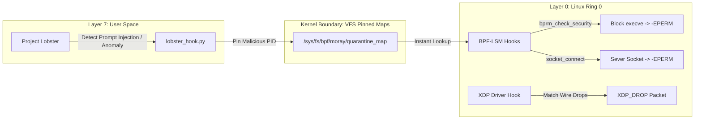

# Project Moray: OS-Level Ring 0 eBPF Containment Architecture

[](https://github.com/codebyangelo/project-moray/actions/workflows/ci.yml)
[](LICENSE)
[](#-quick-architecture-overview)
[](#-subsystems)
[](#-quick-architecture-overview)
[](#-building--running)
[](docs/INVARIANTS.md)

Project Moray (`morayd`) is an ultra-lightweight, zero-dependency in-kernel containment daemon and eBPF security subsystem. Operating in Ring 0 via BPF-LSM and XDP, Moray sits beneath user-space agent frameworks to terminate compromised processes, sever unauthorized network sockets, and drop malicious frames at the driver boundary before user-space context switches complete.

---

## ⚡ Quick Architecture Overview



Detailed architectural blueprints and biological mapping are documented in [`docs/ARCHITECTURE.md`](docs/ARCHITECTURE.md).
Formal security contracts and invariants are documented in [`docs/INVARIANTS.md`](docs/INVARIANTS.md).

---

## 📂 Subsystems

* **`src/moray.h`**: Shared binary headers, quarantine bitmasks, and ring buffer event layouts.
* **`src/moray_kern.bpf.c`**: Ring 0 eBPF C program implementing LSM strike mechanisms (`bprm_check_security`, `socket_connect`) and anti-tamper camouflage (`lsm/bpf`).
* **`src/morayd.c`**: Zero-dependency C daemon mounting `/sys/fs/bpf/moray/` and draining ring buffer telemetry.
* **`bridge/lobster_hook.py`**: Zero-dependency Python ctypes bridge allowing Project Lobster to flag PIDs into the pinned quarantine map.
* **`tests/`**: Invariant test suite verifying struct byte alignment, fail-closed contracts, and strike enforcement.

---

## 🚀 Building & Running

### Requirements
* Linux Kernel 5.15+ (BPF-LSM enabled via `CONFIG_BPF_LSM=y`)
* `clang` / LLVM toolchain with BPF target support
* Python 3.10+ (for bridge integration and test harness)

### Compilation
```bash
make
```

### Running the Daemon
```bash
# Mounts BPF filesystem and pins /sys/fs/bpf/moray/
sudo ./bin/morayd
```

### Quarantine Trigger (via Lobster Hook)
```bash
python3 bridge/lobster_hook.py --pid 1234 --strike
```
