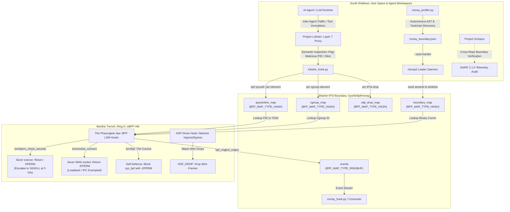

# Project Moray: OS-Level Ring 0 Containment Architecture

[](#-triad-ecosystem-integration)
[](#-predator-prey-biological-mapping)
[](INVARIANTS.md)

Project Moray (`morayd`) implements an OS-level kernel-space containment framework using restricted eBPF primitives in Linux Ring 0. Operating via BPF-LSM and driver-level XDP, Moray sits beneath user-space agent frameworks to terminate compromised processes, sever unauthorized network sockets, and drop malicious frames at the driver boundary before user-space context switches complete.

---

## 🏛️ Predator-Prey Biological Mapping

Project Moray directly translates the predatory biology of the Moray eel (*Muraenidae*) into Linux kernel primitives:



### Anatomical Subsystems

| Biological Trait | Kernel / eBPF Primitive | Architectural Function |
| :--- | :--- | :--- |
| **The Crevice (Anti-Tamper)** | `lsm/bpf` (`moray_bpf_strike`) | Intercepts the `bpf()` syscall from quarantined targets to block probe enumeration, map modification, and hook detachment with `-EPERM` ($I_3, I_7$). |
| **Sensory Pores (Lateral Line)** | `BPF_MAP_TYPE_RINGBUF` (`events`) | Passively streams execution traces, strike counts, and socket severances into a bounded 256KB ring buffer without adding lock contention ($I_4$). |
| **The Outer Jaw (First Contact)** | Project Lobster (Layer 7) | Evaluates prompt injection, unauthorized MCP tool calls, and payload escapes in user space, writing violating PIDs/cgroups into `quarantine_map` ($I_1$). |
| **The Pharyngeal Jaw (The Strike)** | BPF-LSM (`-EPERM`) + `XDP_DROP` | Fires inside Ring 0 before context switches complete, returning `-EPERM` to `execve`, `socket_connect`, and `bpf` syscalls across PIDs, TGIDs, and Cgroup v2 hierarchies, and dropping quarantined wire packets via driver-level `XDP_DROP` ($I_1, I_8$). |
| **Autonomous Reflex (Boundary Engine)** | `moray_boundary_map` (`--auto-harden`) | Enforces autonomous in-kernel execution whitelisting. Seeded from `moray_boundary.json` on boot, unlisted binaries trigger automatic Ring 0 strikes without user-space supervision ($I_9$). |

---

## 📂 Repository Layout

```
project-moray/
├── Makefile                     # Compiles BPF bytecode via clang & manages builds
├── README.md                    # System overview, quickstart & claims truth matrix
├── moray_boundary.json          # Machine-readable boundary manifest for auto-harden
├── docs/                        # Canonical documentation suite
│   ├── ARCHITECTURE.md          # Architectural blueprints & biological mapping (this document)
│   ├── INVARIANTS.md            # Formal invariant definitions ($I_1$–$I_9$)
│   ├── RUNBOOK.md               # Operational procedures & incident response playbooks
│   ├── COMPATIBILITY.md         # Linux kernel distribution capability matrix
│   └── THREAT_MODEL.md          # Ring 0 attack surfaces and adversarial vectors
├── src/
│   ├── moray.h                  # Shared C structs, boundary schemas, and action opcodes
│   ├── moray_bpf.h              # Minimal kernel BPF helper macros & forward definitions
│   ├── moray_kern.bpf.c         # Ring 0 BPF-LSM hooks, XDP filter & boundary engine
│   └── morayd.c                 # User-space loader daemon, auto-harden seeder & ringbuf sink
├── bridge/
│   ├── lobster_hook.py          # Zero-dependency Python ctypes interface for Lobster
│   ├── moray_profiler.py        # Sovereign workspace inspector & boundary synthesizer
│   └── moray_hook.py            # Native Python bridge & NDJSON telemetry consumer
├── tests/
│   ├── test_struct_layout.c     # C static size and byte-alignment verifier
│   ├── victim_worker.c          # Multi-mode adversarial test worker (fork race, burst, WAN)
│   ├── run_live_kernel_test.sh  # 46-step live Ring 0 KVM microVM verification harness
│   ├── test_lobster_hook.py     # Lobster hook invariant & fail-closed regression tests
│   ├── test_autonomous_boundary_e2e.py # Sovereign end-to-end autonomous boundary suite
│   ├── test_cgroup_containment.py      # Cgroup v2 subtree containment integration
│   ├── test_anti_tamper.py      # BPF syscall interception & self-defense verification
│   ├── test_network_policy.py   # Granular WAN vs loopback network policy verification
│   └── test_xdp_filter.py       # Wire-rate XDP packet filtering verification
└── packaging/systemd/
    └── morayd.service           # Production systemd sandboxed service unit
```

---

## ⚡ Triad Ecosystem Integration

1. **[Project Lobster](file:///root/home/projects/project-lobster)** (*The Shell*):
   Acts as the front-line user-space proxy intercepting inter-agent traffic, LLM prompts, and tool outputs. When a semantic breach or privilege escalation is detected, Lobster invokes `lobster_hook.py` to pin the target PID or Cgroup slice into `/sys/fs/bpf/moray/quarantine_map`.

2. **Project Moray** (*The Reef Predator*):
   Lurks silently in Ring 0. Operating at the deepest enforcement substrate, Moray terminates quarantined processes, severs unauthorized network sockets, drops hostile wire frames, and autonomously defends configured process boundaries without user-space round-trips.

3. **[Project Octopus](file:///root/home/projects/project-octopus)** (*The Adversary & Auditor*):
   Red-team validation harness and SARIF 2.1.0 telemetry auditor that stresses both layers: validating L7 evasion resistance in Lobster and low-level escape resistance in Moray.

---

## 🔍 Verification & Claims Truth Matrix

For full empirical ground truth regarding what is verified in real Ring 0 execution vs. what is partially emulated, planned, or explicitly out of scope, refer to the **[Verification & Claims Truth Matrix in README.md](file:///root/home/projects/project-moray/README.md#-verification--claims-truth-matrix)**.
