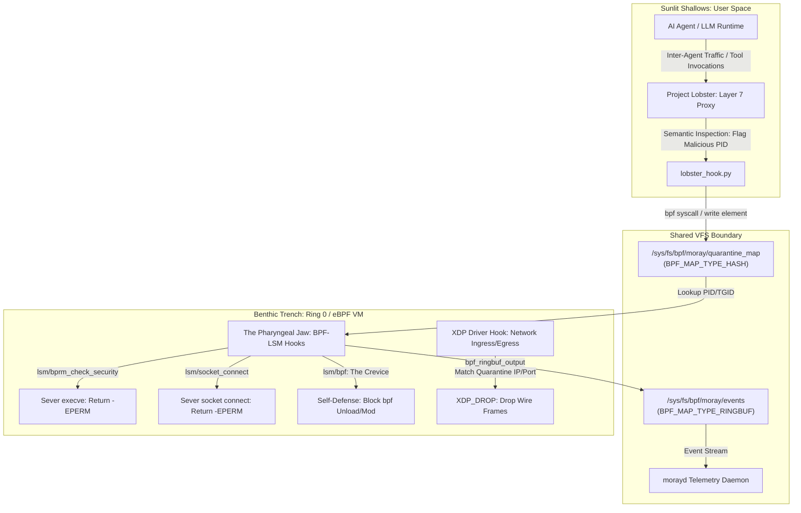

# Project Moray: OS-Level Ring 0 Containment Architecture

[](#triad-ecosystem)
[](#the-pharyngeal-strike)
[](#core-architectural-invariants)

Project Moray (`morayd`) implements an OS-level kernel-space containment framework using restricted eBPF primitives in Linux Ring 0. It serves as the deep enforcement substrate beneath user-space agent proxies, terminating malicious execution before context switches or network frames escape kernel boundaries.

---

## 🏛️ Predator-Prey Biological Mapping

Project Moray directly translates the biology of the Moray eel (*Muraenidae*) into Linux kernel primitives:



### Anatomical Subsystems

| Biological Trait | Kernel / eBPF Primitive | Architectural Function |
| :--- | :--- | :--- |
| **The Crevice (Anti-Tamper)** | `lsm/bpf` (`moray_bpf_strike`) | Intercepts the `bpf()` syscall from quarantined targets to block probe enumeration, map modification, and hook detachment with `-EPERM`. |
| **Sensory Pores (Lateral Line)** | `tracepoint` / `BPF_MAP_TYPE_RINGBUF` | Passively records execution traces, file opens, and socket allocations into a bounded ring buffer without adding lock contention. |
| **The Outer Jaw (First Contact)** | Project Lobster (Layer 7) | Evaluates prompt injection, unauthorized MCP tool calls, and payload escapes in user space, writing violating PIDs into `quarantine_map`. |
| **The Pharyngeal Jaw (The Strike)** | BPF-LSM (`-EPERM`) + `XDP_DROP` | Fires inside Ring 0 before context switches complete, returning `-EPERM` to `execve`, `socket_connect`, and `bpf` syscalls, and dropping quarantined wire packets via driver-level `XDP_DROP`. |

---

## 📂 Repository Layout

```
project-moray/
├── Makefile             # Compiles BPF bytecode via clang & manages builds
├── README.md            # System overview & operational quickstart
├── docs/                # Canonical documentation suite
│   ├── ARCHITECTURE.md  # Architectural specifications (this document)
│   └── INVARIANTS.md    # Formal invariant definitions ($I_1$–$I_6$)
├── src/
│   ├── moray.h          # Shared C structs, map schemas, and action opcodes
│   ├── moray_kern.bpf.c # Ring 0 BPF-LSM hooks & XDP drop logic
│   └── morayd.c         # User-space loader daemon & ringbuf consumer
├── bridge/
│   └── lobster_hook.py  # Zero-dependency Python ctypes interface for Lobster
└── tests/
    ├── test_struct_layout.c # C static size and byte-alignment verifier
    └── test_lobster_hook.py # Invariant & fail-closed regression tests
```

---

## ⚡ Triad Ecosystem Integration

1. **[Project Lobster](file:///root/home/projects/project-lobster)** (*The Shell*):
   Acts as the front-line user-space proxy intercepting inter-agent traffic, LLM prompts, and tool outputs. When a semantic breach or privilege escalation is detected, Lobster invokes `lobster_hook.py` to pin the target PID into `/sys/fs/bpf/moray/quarantine_map`.

2. **Project Moray** (*The Reef Predator*):
   Lurks silently in Ring 0. The moment the target PID is asserted in `quarantine_map`, any subsequent binary execution (`execve`) or network socket creation (`connect`) is severed by BPF-LSM with `-EPERM`, while network traffic matching entries in `xdp_drop_map` is dropped at wire rate via driver-level XDP.

3. **[Project Octopus](file:///root/home/projects/project-octopus)** (*The Adversary*):
   Red-team validation harness designed to subject both layers to pressure: testing L7 evasion techniques against Lobster and low-level syscall escape vectors against Moray.
