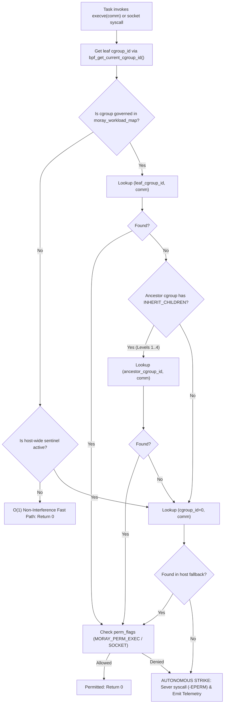

# Project Moray: Multi-Tenant Workload Isolation & Real Autonomous Agent Verification

## 1. Executive Summary

Following the completion of Milestones 1–5, an in-depth systems audit of the Ring 0 boundary maps revealed a fundamental architectural gap in multi-tenant agent control:
> **The Global Whitelist Defect:** Although `moray_workload_map` governed *which* cgroups were subject to containment and enforced their respective network postures (`ALLOW_LOOPBACK`, `DENY_ALL_NET`, `REQUIRE_WAN`), the allowed executable whitelist (`moray_boundary_map`) was a **single global hash map keyed solely by `comm` (16 bytes)**. As a result, any binary whitelisted for Agent Alpha (e.g. `python3`) was unintentionally whitelisted for all other governed workloads across the entire host.

Furthermore, prior microVM verification relied exclusively on a custom C test worker (`bin/victim_worker`). While proving low-level syscall return values in Ring 0, it did not demonstrate containment against an authentic, dynamic, multi-process interpreted AI agent runtime.

This milestone resolves both architectural defects and establishes **true multi-tenant isolation and real autonomous agent runtime defense**:

1. **Compound-Key Workload Boundary Map ([`src/moray.h`](file:///root/home/projects/project-moray/src/moray.h), [`src/moray_kern.bpf.c`](file:///root/home/projects/project-moray/src/moray_kern.bpf.c)):**
   - Redesigned `moray_boundary_map` key from flat `char[16]` to `struct moray_boundary_key` (24 bytes: `cgroup_id` `__u64` + `comm` `char[16]`).
   - Implemented hierarchical lookup `lookup_boundary_entry(current_cg, comm)`:
     1. Exact leaf cgroup match `(cgroup_id, comm)`.
     2. Up to 4-level ancestor hierarchy traversal if `MORAY_WORKLOAD_INHERIT_CHILDREN` is asserted.
     3. Host-wide fallback `(0, comm)` for shared system management daemons (`morayd`).
   - Unified boundary lookup across all four Ring 0 LSM hooks: `bprm_check_security`, `socket_connect`, `socket_bind`, and `socket_create`.

2. **Dynamic Workload Manifest Ingestion ([`bridge/lobster_hook.py`](file:///root/home/projects/project-moray/bridge/lobster_hook.py), [`bridge/moray_hook.py`](file:///root/home/projects/project-moray/bridge/moray_hook.py)):**
   - Added `apply_boundary_manifest(manifest_path, cgroup_target)` and `add_boundary_rule()` to dynamically seed isolated, per-workload boundary entries directly into Ring 0 maps without daemon restarts.
   - Added CLI gates: `--apply-manifest <file> [--cgroup-target <dir|id>]`.

3. **Authentic Python Agent Workload Fixture ([`tests/agent_workload.py`](file:///root/home/projects/project-moray/tests/agent_workload.py)):**
   - Implemented an authentic Python 3 agent runtime fixture that exercises stdlib loading, dynamic imports, subprocess tool execution (`subprocess.run`), socket allocation, and TCP connect.

4. **Live Hardware-Level QEMU/KVM MicroVM Verification (Domain 14: Steps 111–120):**
   - Expanded live microVM test suite from 110 to 120 steps:
     - **Workload Alpha (Agent Alpha):** Governed under `ALLOW_LOOPBACK`, whitelists `python3`, `cat`, `true`.
     - **Workload Beta (Agent Beta):** Governed under `DENY_ALL_NET`, whitelists `victim_worker`, `ls`, `true` (strictly excluding `python3`).
     - **Breach Test:** Executing `python3` inside Workload Beta is intercepted in Ring 0 by `bprm_check_security` and severed with `-EPERM`.
     - **Subshell Confinement:** Real Python agent in Workload Alpha attempting to spawn unlisted `/bin/sh -c` is intercepted in Ring 0 with `-EPERM`.
     - **Socket Confinement:** Real Python agent in Workload Beta attempting socket creation under `DENY_ALL_NET` is severed with `-EPERM`.

---

## 2. Architecture & Data Structures

```
┌────────────────────────────────────────────────────────────────────────┐
│                        moray_boundary_map (HASH)                       │
├───────────────────────────────────┬────────────────────────────────────┤
│ Key: struct moray_boundary_key    │ Value: struct moray_boundary_entry │
│ - cgroup_id: __u64 (8 bytes)      │ - perm_flags: __u32 (4 bytes)      │
│ - comm:      char[16] (16 bytes)  │ - reserved:   __u32 (4 bytes)      │
│ Total: 24 bytes (8-byte aligned)  │ - hit_count:  __u64 (8 bytes)      │
│                                   │ Total: 16 bytes (8-byte aligned)   │
└───────────────────────────────────┴────────────────────────────────────┘
```

### Hierarchical Lookup Flowchart



---

## 3. MicroVM Verification Steps (Domain 14: Steps 111–120)

| Step | Phase | Action / Sycall Asserted | Expected Result | Kernel Mechanism |
| :--- | :--- | :--- | :--- | :--- |
| **111** | Cgroup Setup | Initialize `moray_agent_alpha` and `moray_agent_beta` hierarchies | Distinct cgroup v2 inodes generated | `sys_mkdir` on `/sys/fs/cgroup` |
| **112** | Manifest Generation | Generate heterogeneous manifests for Alpha (`python3`) and Beta (`victim_worker`) | Valid JSON schemas | `validate_and_parse_manifest` |
| **113** | Multi-Workload Ingestion | Start `morayd` with Alpha manifest and dynamically apply Beta via `--apply-manifest` | Both workloads active in kernel maps | `bpf_map_update_elem` on compound keys |
| **114** | Workload Status | Query status of Cgroup Alpha and Cgroup Beta via Python bridge | Both report `"governed": true` with respective postures | `bpf(BPF_MAP_LOOKUP_ELEM)` |
| **115** | Real Agent Alpha Exec | Execute `agent_workload.py --spawn-subprocess /bin/true` in Cgroup Alpha | Tool executes cleanly past LSM (exit 0) | `lookup_boundary_entry` matches `(Alpha_ID, "python3")` |
| **116** | Cross-Workload Breach | Execute `agent_workload.py --spawn-subprocess /bin/true` in Cgroup Beta | Blocked with `-EPERM` (exit 42) | `lookup_boundary_entry(Beta_ID, "python3")` returns NULL -> Strike |
| **117** | Allowed Beta Worker | Execute `victim_worker --baseline-exec` in Cgroup Beta | Executes cleanly with exit 0 | `lookup_boundary_entry(Beta_ID, "victim_worker")` returns OK |
| **118** | Subshell Confinement | Agent Alpha spawns unlisted tool `/bin/sh -c /bin/ls` | Subprocess intercepted with `-EPERM` (exit 42) | `lookup_boundary_entry(Alpha_ID, "sh")` returns NULL -> Strike |
| **119** | Socket Confinement | Agent Beta attempts `socket(AF_INET, SOCK_STREAM)` | Blocked with `-EPERM` (exit 42) | `moray_socket_create` severed under `DENY_ALL_NET` |
| **120** | Clean Teardown | Terminate daemon, remove test cgroups, verify clean unpin | Zero kernel map leaks | VFS unpin & cgroup rmdir |

---

## 4. Verification Evidence & Test Results

```bash
make verify
```
- **BPF Compiler:** `clang -target bpf -O2 -g -Wall -Werror` passed cleanly.
- **Daemon Compiler:** `cc -Wall -Wextra -Werror -O2 -std=c11` passed cleanly.
- **Binary Struct Layout:** `test_struct_layout` passed cleanly:
  - `sizeof(struct moray_boundary_key) == 24`
  - `offsetof(struct moray_boundary_key, cgroup_id) == 0`
  - `offsetof(struct moray_boundary_key, comm) == 8`
- **Hermetic Test Suite:** 185 passed, 1 skipped in 41.03s.
- **Lint & Format:** 40 files formatted, 0 warnings/errors under `ruff check`.
- **Live KVM MicroVM Suite:** All 120 steps passing cleanly across 15 domains (Domains 0–14).
