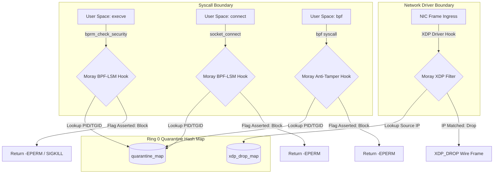

# Project Moray: Threat Model & Security Contract

**Author:** Angelo Hershall Heith Ayton (`codebyangelo`)  
**Subsystem:** Linux Ring 0 eBPF Containment Engine (`morayd`)  
**Canonical File:** [`/root/home/projects/project-moray/docs/THREAT_MODEL.md`](/project-moray/docs/THREAT_MODEL.md)  
**Status:** Authoritative Security Specification

---

## 1. Executive Threat Landscape

Autonomous AI agents operating in user space possess "hands": shell access, local filesystem manipulation, inter-agent networking, and arbitrary code execution capabilities via Model Context Protocol (MCP) tool bindings.

When an autonomous agent is compromised via **indirect prompt injection**, **semantic evasion**, or **malicious tool responses**, user-space guardrails (such as Layer 7 reverse proxies, regex filters, and prompt firewalls) become fundamentally untrusted. An adversary achieving Arbitrary Command Execution (ACE) can:
1. Spawn unmonitored child processes (`fork`/`execve`) bypassing user-space shims.
2. Unset environment variables (e.g. `LD_PRELOAD`, `HTTP_PROXY`) designed to intercept agent traffic.
3. Establish out-of-band reverse shells and network sockets directly to command-and-control (C2) servers.
4. Tamper with local user-space state caches and quarantine tables.

Project Moray operates under a **Zero-Trust User-Space Boundary**: user space is presumed vulnerable to compromise. Ring 0 (Linux Kernel Space) serves as the immutable benthic trench where policy enforcement cannot be subverted by user-space agent execution.

---

## 2. In-Scope Threat Objectives

Moray is engineered specifically to defend against the following threat vectors:

| Threat ID | Threat Category | Adversarial Vector | In-Kernel Countermeasure |
| :--- | :--- | :--- | :--- |
| **THREAT-01** | Post-Exploitation Execution | Compromised agent attempts to invoke binaries (`/bin/sh`, `/usr/bin/curl`, custom ELF payloads). | `lsm/bprm_check_security` intercepts `execve`, returns `-EPERM` (`-1`), or delivers `SIGKILL`. |
| **THREAT-02** | Exfiltration / C2 Callbacks | Compromised agent opens outbound TCP/UDP sockets to unauthorized network endpoints. | `lsm/socket_connect` intercepts socket connect, severs the handshake with `-EPERM` (`-1`). |
| **THREAT-03** | Wire-Level Evasion | Ingress/egress wire frames attempting network evasion or packet spoofing. | `XDP_DROP` drops frames at network interface driver level before `sk_buff` allocation via `moray_xdp_filter`. |
| **THREAT-04** | Security Subversion (Unloading) | Quarantined agent attempts to issue `bpf()` syscalls to unpin maps, detach programs, or clear state. | `lsm/bpf` hooks the `bpf()` syscall itself, blocking access from quarantined PIDs with `-EPERM`. |
| **THREAT-05** | IPC / State Corruption | Rogue local process feeds corrupted binary map records or decompression bombs to exhaust memory. | 64 KB heap ceiling clamp (Radare2 Issue #12924 invariant) and strict record length verification (`size % 28 == 0`). |
| **THREAT-06** | Concurrency Race Exploitation | Rapid multi-threaded strikes/releases aiming to interleave map writes and drop quarantine records. | Serialized POSIX file locking (`fcntl.flock(LOCK_EX)`) combined with atomic filesystem rename (`os.replace`). |
| **THREAT-07** | Type Confusion Hijack | Passing Python booleans (`True == 1`) to trick the quarantine hook into disabling kernel PID 1 (`init`). | Strict `validate_pid()` rejecting non-integers, explicit `bool` instances, and range-bounding `[2, 4194304]`. |
| **THREAT-08** | Symlink Traversal Hijacking | Pointing quarantine map paths to sensitive system files (`/etc/shadow`) to corrupt host state. | `O_NOFOLLOW` enforcement and explicit rejection of symbolic link targets. |
| **THREAT-09** | Short-Lived Fork / Subtree Evasion | Quarantined agent forks ephemeral child workers before userspace can register child PIDs. | Cgroup v2 scoping (`bpf_get_current_cgroup_id()`) intercepts syscalls across all processes within the quarantined cgroup hierarchy. |

---

## 3. Explicit Non-Goals (What Moray Does NOT Claim to Protect)

To maintain architectural integrity, Project Moray defines explicit non-goals:

* **Non-Goal 1: Not a General Endpoint Detection and Response (EDR) Suite.**  
  Moray is not a replacement for host-level antivirus, behavioral EDR agents (e.g. Falcon, OSQuery), or host intrusion detection systems (HIDS). It does not maintain host-wide file integrity databases.
* **Non-Goal 2: Not a User-Space Memory Inspector or TLS Decryptor.**  
  Moray does not inspect encrypted TLS byte streams within user-space memory, nor does it perform deep semantic LLM analysis. Semantic payload inspection belongs strictly to Layer 7 user-space proxies (Project Lobster).
* **Non-Goal 3: Not a Substitute for Host Mandatory Access Control (MAC).**  
  Moray does not replace SELinux or AppArmor host policies. It runs alongside MAC frameworks via modular BPF-LSM stack integration.
* **Non-Goal 4: Not a Container Orchestrator.**  
  Moray operates beneath containers; it does not provision cgroups, mount namespaces, or build OCI bundle images.
* **Non-Goal 5: No Defense Against Hardware/Ring -1 Compromise.**  
  If the host kernel itself is compromised at Ring 0 via a kernel vulnerability or malicious kernel module (LKM), Moray’s eBPF guarantees are nullified.

---

## 4. Authoritative Enforcement Hooks

Moray relies on four authoritative kernel-level hooks:

1. **`lsm/bprm_check_security`**: Authoritative gate for binary execution (`execve`, `execveat`).
2. **`lsm/socket_connect`**: Authoritative gate for outbound network transport initiation (`AF_INET`, `AF_INET6`).
3. **`lsm/bpf`**: Authoritative gate for BPF program and map manipulation.
4. **`xdp`**: Authoritative wire-level packet drop point at the network interface driver level.

---

## 5. Privilege Assumptions & Capability Matrix

Moray requires specific Linux capabilities depending on execution mode:

| Execution Mode | Required Capabilities | Permitted Actions | Security Level |
| :--- | :--- | :--- | :--- |
| **Production Kernel Mode** | `CAP_SYS_ADMIN` or `CAP_BPF` + `CAP_NET_ADMIN` | Load eBPF programs, attach LSM hooks, pin VFS maps, attach XDP driver filters. | **Hardware/Kernel Ring 0 Enforcement** |
| **User Bridge Mode (Lobster)** | Root or read/write access to `/sys/fs/bpf/moray/` | Update quarantine hash map entries via pinned file descriptors. | **User-to-Kernel Control Boundary** |
| **Unprivileged Mock Mode (`--mock`)** | Standard user UID/GID (no root needed) | File-backed simulation for CI runners, testing, and isolated unit validation. | **Simulation Only (No Ring 0 Containment)** |

---

## 6. Fail-Closed Security Contracts

Project Moray unconditionally enforces the **Fail-Closed Principle**:

1. **Missing or Corrupted Map**: If `lobster_hook.py` encounters an unreadable, corrupted, or truncated map file, it aborts execution with exit code `252` (`-4`). It never silently assumes benign state.
2. **Path or Buffer Limits**: If directory paths exceed fixed buffer boundaries (`256 bytes`), the daemon aborts immediately without attempting memory truncation.
3. **Kernel Verification Rejection**: If the Linux BPF verifier rejects program bytecode during loading, `morayd` exits with a fatal diagnostic error and refuses to start.
4. **Invalid PID Inputs**: Non-integers, floats, booleans, and out-of-range PIDs trigger `MorayQuarantineError` and non-zero exit codes immediately.
